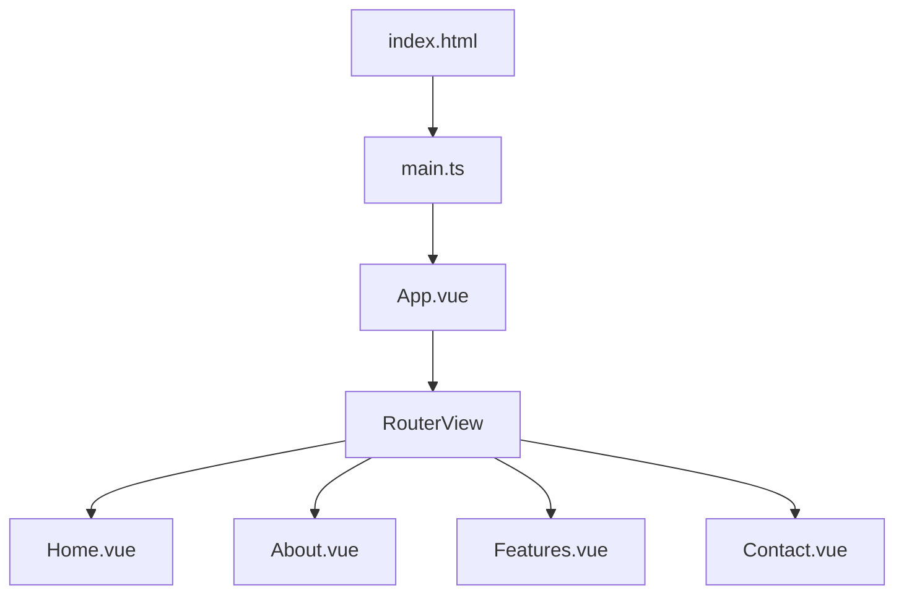

# Navodila za namestitev in delovanje
## MacOS in Windows
Instaliraj node_modules
```bash
npm install
```
Zaženi
```bash
npm run dev
```

## Jeziki

Frontend uporablja Vue I18n. Preklopnik **SL / EN** je v navigaciji tudi na
telefonu. Privzeti jezik je slovenščina; izbira se shrani v `localStorage`
pod ključem `vzvodno-language`.

Besedila urejaj v `src/locales/sl.ts` in `src/locales/en.ts`; obe datoteki
morata imeti enake ključe. V komponentah uporabljaj `t('home.calculate')`,
za številke `n(vrednost, 'decimal')`, za datume pa `d(datum, 'short')`.
Nastavitve, zapis izbire ter jezik in naslov dokumenta so v `src/i18n.ts`.

Preklop jezika ohrani vnose in prikazane rezultate simulacije. Ob kliku Izračunaj
frontend zajame `language: locale.value` in ga pošlje v obeh POST-zahtevah.
Backend pripravi grafe v tem jeziku in za vsak graf vrne en `url`.
Jezik že pripravljenih grafov se ob preklopu jezika strani ne spremeni;
za grafe v drugem jeziku je treba ponovno klikniti Izračunaj.



